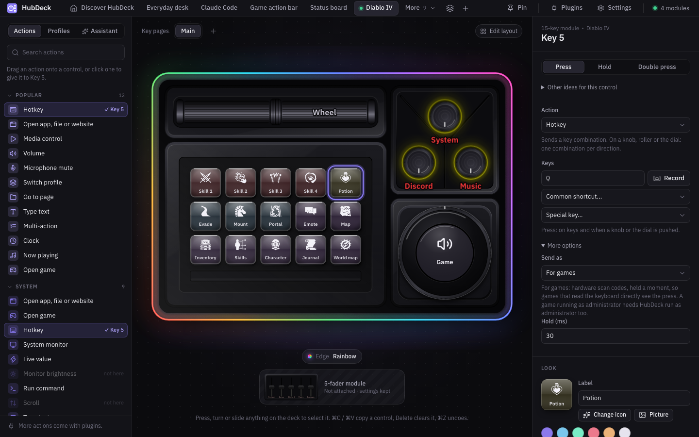
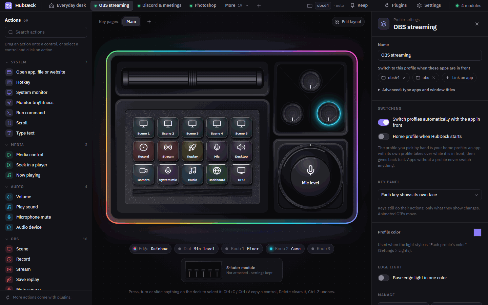
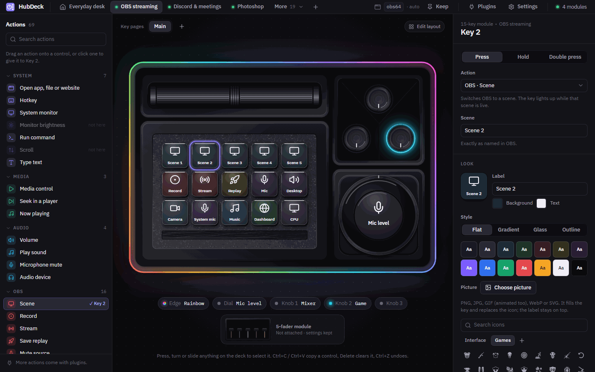
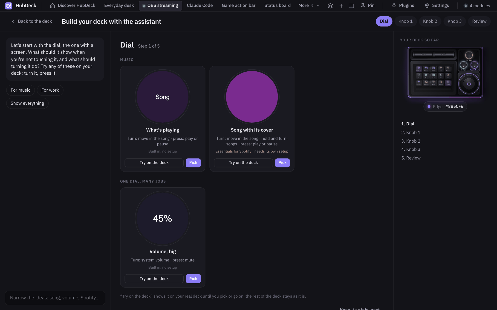

# HubDeck

Open-source desktop app for the **Cooler Master MasterHUB** modular controller. It does everything
the official app did and a lot more with the same hardware, with no account, no cloud and no
telemetry. Windows and macOS. It runs plugins made for Stream Deck, and an AI assistant can build
your deck with you.

> HubDeck is an independent project. It is not made, endorsed or supported by Cooler Master.
> "Cooler Master" and "MasterHUB" are trademarks of their owner and are used here only to say
> which hardware this software works with.


## Why

The MasterHUB is good hardware: a base with an edge light, and modules you arrange as you like (15
LCD keys, a dial with a round screen, knobs, faders, rollers). Its official software has not kept up:
pieces promised to backers (an SDK, macOS support, more integrations) have not arrived, updates are
rare, and owners ask about bugs and whether it will stay supported
([what we found](docs/OFFICIAL-APP.md)). HubDeck is a new, open app for the same hardware, so the
deck keeps working and keeps getting better. The protocol was worked out from public research and checked
module by module on real hardware; see [PROTOCOL.md](PROTOCOL.md).

## What it does

**Deck and modules**
- Every module: 15 keys, dial with its 240x240 screen, knobs, faders, rollers and the base. Attach and
  remove modules while it runs; HubDeck finds where each one sits and how it is turned.
- The window draws your deck as it is on the desk, live: key pictures, dial screen, LED colors and
  the edge light. Press, turn or slide anything to select it.
- Modules you own but have not attached stay on a shelf beside the deck, still editable.

**Profiles that follow you**
- Your home profile is the one you pick. An app with its own profile takes over while it is in
  front (even one window: `chrome.exe: YouTube`) and gives back when you leave it; *Pin* stops
  switching. Switching is drawn in tens of milliseconds.
- Key pages, press / hold / double press on every key, knob and the dial, multi-actions with delays
  and conditions, a keyboard macro recorder, toggles, several modes on one dial.
- Profiles in a OneDrive or Dropbox folder to share them between PCs; daily backups with
  one-click restore; import of profiles exported by the official app (`.mhz`).

**Actions**
- Open apps, files and websites (with the app's own icon), run commands, hotkeys (F13-F24, media
  keys, and a mode that games can read), type text, scroll.
- System, per-app, "app in front" and microphone volume (per app on macOS 14.2 or later); microphone mute for every app; switch the
  speakers or microphone; play sounds (a small soundboard).
- Media control, now playing with cover art, seek in 12 players; monitor brightness (DDC/CI);
  system monitor (CPU, memory, GPU, temperatures, on macOS too); clock and timer; deck brightness.

**Plugins made for Stream Deck**
- Install a `.streamDeckPlugin`, or pick one from a catalog of about 200 open-source plugins
  (Settings > Plugins), and its actions join the library: Discord, Spotify, OBS, Home Assistant,
  Philips Hue, Govee, VS Code and more. Keys are a 5x3
  keypad, the dial and knobs are dials, the plugin's own settings page shows in the inspector.
  How it works and what to expect: [docs/STREAMDECK-PLUGINS.md](docs/STREAMDECK-PLUGINS.md).

**A tour, then a deck assistant**
- *Show me on my deck* (no AI needed): one question about what you do most, then HubDeck makes a
  deck for your modules and your apps at once and walks you through it on the hardware, part by
  part; the control to try blinks on the deck. Keep the parts you like; nothing of yours changes
  until you keep the deck. With your OK it counts presses, and the next day names a control you
  never used, to swap it.
- The assistant uses your own Claude Code: it looks at the apps you use (with your OK), asks a few questions and
  sketches whole decks you try on the hardware before you keep one; or go step by step, control
  by control, through a gallery of options. It changes only drafts; more in
  [docs/ASSISTANT.md](docs/ASSISTANT.md).
- Your own apps and scripts can show their state on the deck (an agent waiting, a build running)
  and offer actions: [docs/APP-CONTRACT.md](docs/APP-CONTRACT.md).

**Integrations**
- OBS Studio and Streamlabs Desktop: scenes, record, stream, replay, sources, mixer, with the live
  state on the keys.
- Spotify (like, playlists), Home Assistant (devices, scenes, lights, services), MIDI to any DAW.
- Twitch (chat, markers, clips, ads, title): needs a Twitch app registration in the build that is
  not done yet, so its sign-in is off for now.
- Claude Code: a key per coding session that shows whether it works, needs your permission or
  waits for you. Only the state and the project folder name are sent; never your prompts.
- Plugins in any language over a local WebSocket, and a local API for scripts; see
  [docs/PLUGINS.md](docs/PLUGINS.md).

**Lights**
- One lighting style for the whole deck, or a color and effect per knob and fader and for the edge.
- Lights that mean something: a muted microphone, being on air, a session that needs you, a timer
  that ran out, levels as brightness.

**Key looks**
- Labels, colors, styles (flat, gradient, glass, outline), your own pictures and animated GIFs, one
  picture, a clock or a live graph across all 15 keys.
- Lucide icons and 300 game icons (game-icons.net) with search; install icon packs, including
  Stream Deck icon packs.

**Ready-made profiles**
- Everyday desk, OBS streaming, Discord and meetings, Photoshop, Illustrator, Lightroom, video
  editing, Claude Code, a game action bar, and games on their default keys: Diablo IV, Baldur's
  Gate 3, Counter-Strike 2, Valorant, Fortnite, Minecraft, League of Legends
  ([how to set up a game](docs/GAMES-SETUP.md)). Each one adapts to the modules you have.

**Sharing**
- A profile and all its pictures as one `.hubdeck` file. A shared gallery inside the app is ready
  and will open when the gallery repository is online ([docs/SHARING.md](docs/SHARING.md)).

**Safe and light**
- The module firmware is never updated or changed. Commands that could rewrite serial numbers,
  reset a module or flash firmware are not part of HubDeck's protocol code, and hand-built reports
  carrying them are refused.
- No account, no cloud, no telemetry. HubDeck goes online only for what you turn on: an integration,
  the gallery, the update check.
- About 1 % of one CPU core and 45 MB of memory while it waits in the tray (measured on the
  release build with the deck attached); the window exists only while it is open.
- Tray app that starts with the system; dark and light look; *Reduce motion* (nothing blinks or
  flashes); English and Polish.

| | |
|---|---|
|  |  |
|  |  |
|  |  |

## Install

Download from [Releases](https://github.com/Przemotar/hubdeck/releases).

**Windows 10 and 11**: run `HubDeck_x.y.z_x64-setup.exe`. Windows SmartScreen may say it does not
know the app (it is not signed with a paid certificate): choose *More info > Run anyway*.

**macOS 12 or later** (Apple silicon and Intel): open the `.dmg` and drag HubDeck to Applications.
The app is not notarised by Apple yet, so the first time macOS says it "could not verify" HubDeck.
Once only:

1. Click *Done* (not *Move to Trash*).
2. Open System Settings > Privacy & Security, scroll to Security and click *Open Anyway* next to
   the line about HubDeck; confirm with your password or Touch ID.
3. Click *Open* in the next message.

On macOS 14 and older, right-click HubDeck in Applications and choose *Open* also works. To send
shortcuts and type text from the deck, allow HubDeck in Privacy & Security > Accessibility; the
app asks for it with a button. Setting one app's own volume (macOS 14.2 or later) asks once for
System Audio Recording: HubDeck plays that app's sound at the level you set and records nothing.

Close the official MasterHUB app first: two apps cannot drive the deck at once.

### Known issues

- macOS: after HubDeck restarts, the keys or the dial sometimes stop taking pictures; HubDeck
  restarts that module by itself, and taking it off the base and putting it back always helps.
- macOS 12 to 14.1: one app's own volume cannot be set (the system and the player can).
- Elgato Marketplace plugins with copy protection do not run; plugins from their authors' own
  pages do.
- Twitch sign-in is off until the app registration is done. Linux is not supported.

## Build from source

You need Rust (1.90 or later), Node 22 or later with pnpm, and on Windows the Visual Studio C++
build tools. Step-by-step setup for Windows and macOS: [docs/SETUP.md](docs/SETUP.md).

```
cd app
pnpm install
pnpm tauri dev      # run with hot reload
pnpm tauri build    # installers in target/release/bundle/
```

Tests: `cargo test -p mh-protocol -p mh-device -p hubdeck` and `pnpm test` in `app/`. Without the
hardware, `pnpm dev` and http://localhost:1420/?demo show the window with a sample deck.

How it is built:

- `crates/mh-protocol`: the HID protocol of the modules (encode and decode, no I/O), as verified on
  hardware in [PROTOCOL.md](PROTOCOL.md).
- `crates/mh-device`: USB HID transport and the hot-plug hub.
- `app/`: the Tauri 2 app, the engine in Rust (`app/src-tauri/src/engine/`) and the window in React.

More in [ARCHITECTURE.md](ARCHITECTURE.md).

## Feedback and contributing

- Something does not work: [report a problem](https://github.com/Przemotar/hubdeck/issues/new?template=bug.yml)
  (Settings > Help and feedback fills in your version and saves a diagnostics file to attach).
- An idea: [suggest a feature](https://github.com/Przemotar/hubdeck/issues/new?template=feature.yml).
- Questions, setups, profiles: [Discussions](https://github.com/Przemotar/hubdeck/discussions).
- Anything you prefer not to post in public: przemotar+hubdeck@gmail.com
- Code: see [CONTRIBUTING.md](CONTRIBUTING.md).

## License

HubDeck is licensed under either of [Apache License, Version 2.0](LICENSE-APACHE) or
[MIT license](LICENSE-MIT) at your option. Unless you explicitly state otherwise, any contribution
you submit for inclusion in this project, as defined in the Apache-2.0 license, shall be dual
licensed as above, without any additional terms or conditions.

Third-party icons and fonts keep their own licences (Lucide ISC, game-icons.net CC BY 3.0, IBM Plex
OFL): see [NOTICE.md](NOTICE.md).

## About

Made by **Przemysław Tarkowski** (przemotar+hubdeck@gmail.com), from scratch: the USB protocol of
every module was worked out and checked on real hardware, then the app was written around it.
It was built with [Claude Code](https://claude.com/claude-code) as the main tool; the story, the
numbers and the decisions are in [docs/CASE-STUDY.md](docs/CASE-STUDY.md).
