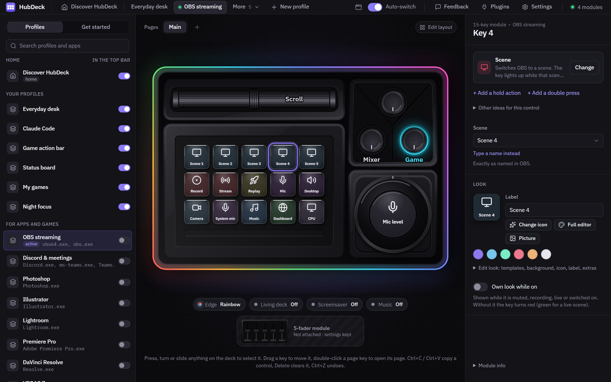
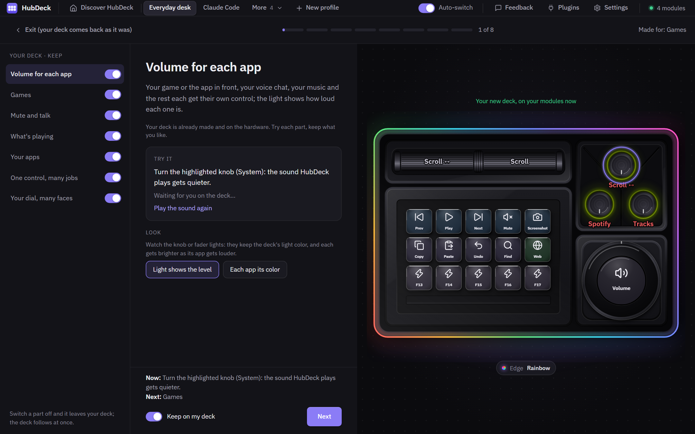
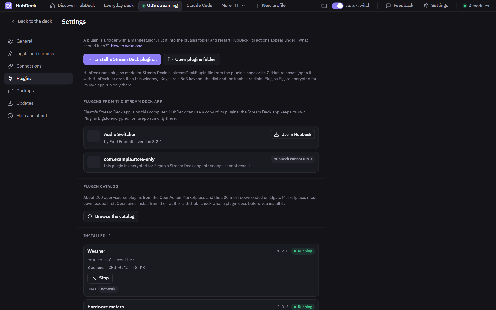

<p align="center">
  
</p>

<h1 align="center">HubDeck</h1>

<p align="center">
  <b>The free, open-source app for the Cooler Master MasterHUB modular deck</b>,<br>
  an alternative to the official MasterHUB software.<br>
  Windows and macOS. No account, no cloud, no telemetry.
</p>

<p align="center">
  <a href="https://github.com/Przemotar/hubdeck/releases/latest"></a>
  <a href="https://github.com/Przemotar/hubdeck/actions/workflows/ci.yml"></a>
  <a href="#license"></a>
  
</p>

<p align="center">
  <a href="https://github.com/Przemotar/hubdeck/releases/latest/download/HubDeck-windows-x64-setup.exe"><b>Download for Windows</b></a> ·
  <a href="https://github.com/Przemotar/hubdeck/releases/latest/download/HubDeck-macos.dmg"><b>Download for macOS</b></a> ·
  <a href="https://przemotar.github.io/hubdeck/">Website</a> ·
  <a href="#documentation">Docs</a> ·
  <a href="#faq">FAQ</a>
</p>




> HubDeck is an independent project. It is not made, endorsed or supported by Cooler Master.
> "Cooler Master" and "MasterHUB" are trademarks of their owner and are used here only to say
> which hardware this software works with.

## Quick start

1. [Download for Windows](https://github.com/Przemotar/hubdeck/releases/latest/download/HubDeck-windows-x64-setup.exe) or [for macOS](https://github.com/Przemotar/hubdeck/releases/latest/download/HubDeck-macos.dmg) and install it ([step by step](#install)).
2. Quit the official MasterHUB app: two apps cannot drive the deck at once.
3. Open HubDeck from the tray and click **Show me on my deck**: one question, and in about five
   minutes your deck is set up for your modules and apps. No account and no AI needed.

## Supported modules

| Module | Windows 10/11 | macOS 12+ |
|---|---|---|
| Base with the edge light | ✓ | ✓ |
| 15 LCD keys | ✓ | ✓ |
| Dial with its round screen | ✓ | ✓ |
| 3 knobs | ✓ | ✓ |
| 5 faders | ✓ | ✓ |
| 2 rollers | ✓ | ✓ |

Checked module by module on real hardware. Attach and take off modules while HubDeck runs; it finds
where each one sits and how it is turned. One base at a time for now.

## Highlights

- **Every module, live.** 15 LCD keys, the round dial, knobs, faders, rollers and the edge light,
  found and drawn as they sit on your base, while it runs.
- **A deck made for you in minutes.** Say what you do most; HubDeck builds a deck for your modules
  and apps and walks you through it on the hardware. No AI needed.
- **Profiles that follow the app in front**, with per-app volume, mute, media with cover art, OBS,
  Home Assistant, monitor brightness and system stats.
- **Stream Deck plugins** run in HubDeck: a one-click catalog of about 200 open-source ones
  (Settings > Plugins). Tried so far: Essentials for Spotify; tell us when one does not work.
- **Safe by design.** Firmware is never written; dangerous commands are refused in code. Nothing
  leaves your computer unless you turn it on ([PRIVACY.md](PRIVACY.md)).
- **Light.** About 3 % of one CPU core and 40 MB of memory in the tray with a clock and meters on the keys; 9 % and 62 MB with 22 animations on the deck (Windows, measured before the release).

## Built from what deck owners complain about

Before and while building HubDeck we read what owners of the MasterHUB and of other decks (Stream
Deck, Loupedeck, Logitech MX Creative Console, Razer Stream Controller) say goes wrong: reviews,
vendor forums, GitHub issues and about 1,200 Reddit posts of 2025-2026. The ones that shaped HubDeck
most, with their sources:

| What owners say | What HubDeck does |
|---|---|
| "Nearly every update ... breaks almost everything"; people roll back by hand ([r/elgato](https://redd.it/1tg0k8o), [r/elgato](https://redd.it/1vhfyp9)) | Nothing installs until you click Install, with the changes shown first; **Go back to the version before** in Settings, signed like any update, your profiles backed up first |
| A press does nothing, or arrives seconds later, and you cannot tell which ([r/elgato](https://redd.it/1tin7ed)) | Every press **frames the key at once**; an action that failed leaves a **red corner** and the window says why |
| Official integrations broken for weeks: OBS, weather, Spotify ([r/elgato](https://redd.it/1tu968o), [r/elgato](https://redd.it/1u7j0sq)) | OBS, Streamlabs, now playing, weather and Home Assistant are **built in**; Stream Deck plugins run beside them, restarted when they crash, stoppable by hand |
| Forced accounts, a store, an ad in paid software ([r/elgato](https://redd.it/1vei16t), [r/elgato](https://redd.it/1ueyj99)) | **No account, no store, no ads, no telemetry.** Open source |
| The vendor walks away and the hardware becomes a brick ([r/Loupedeck](https://redd.it/1ux25ju), the MasterHUB itself) | MIT or Apache-2.0, the protocol documented in [PROTOCOL.md](PROTOCOL.md): anyone can keep it going |
| "What do I use it for if I don't stream?" (the most discussed non-hardware thread, [r/elgato](https://redd.it/1wh69jh)) | A tour builds a deck for your modules and apps in minutes; **ideas from other deck owners**, taken from that thread, are one click away |
| Companion apps that take 2-4 GB of memory ([Logitech reviews](https://www.target.com/p/logitech-mx-creative-console-9-customizable-buttons-with-lcd-screens-graphite/-/A-1006718799)) | Measured before every release: 9.4 % of one CPU core and 62 MB with 22 animations on the deck, memory flat over 5 minutes (Windows) |
| "Commands did not save properly", a setup lost ([APH Networks](https://aphnetworks.com/reviews/cooler-master-masterhub/2)) | Every change saved at once and written safely; daily backups with Restore |

## Install

Download from [Releases](https://github.com/Przemotar/hubdeck/releases).

**Windows 10 and 11**: run `HubDeck_x.y.z_x64-setup.exe`. Windows SmartScreen may say it does not
know the app (it is not signed with a paid certificate): choose *More info > Run anyway*.

**macOS 12 or later** (Apple silicon and Intel): open the `.dmg` and drag HubDeck to Applications.
The app is not notarised by Apple yet, so the first time macOS says it "could not verify" HubDeck.
Once only:

1. Click *Done* (not *Move to Trash*).
2. Open System Settings > Privacy & Security, scroll to Security and click *Open Anyway* next to
   the line about HubDeck; confirm with your password or Touch ID.
3. Click *Open* in the next message.

On macOS 14 and older, right-click HubDeck in Applications and choose *Open* also works. To send
shortcuts and type text from the deck, allow HubDeck in Privacy & Security > Accessibility; the
app asks for it with a button. Setting one app's own volume (macOS 14.2 or later) asks once for
System Audio Recording: HubDeck plays that app's sound at the level you set and records nothing.

Close the official MasterHUB app first: two apps cannot drive the deck at once.

### Known issues

- macOS: this version's window was last tried on a Mac before its rebuild (2026-10-15); the macOS
  build comes from CI and has not yet run on a Mac. Please report what you see.
- The window shows the deck's animations (GIFs, the screensaver) at about 8 frames a second; the
  deck itself plays them at 15 or more.
- macOS: after HubDeck restarts, the keys or the dial sometimes stop taking pictures; HubDeck tries
  to restart that module by itself, and taking it off the base and putting it back always helps.
- macOS 12 to 14.1: one app's own volume cannot be set (the system and the player can).
- Elgato Marketplace plugins with copy protection do not run; plugins from their authors' own
  pages do.
- Twitch sign-in is off until the app registration is done. Linux is not supported.
- A module that drops off USB when you press it (Windows plays its unplug sound, the keys go blank
  for a moment) has a loose contact with the base: take it off and put it back firmly.

## What it does

<details>
<summary><b>Everything in detail</b> (modules, profiles, actions, plugins, the tour and the assistant, integrations, lights, looks, ready-made profiles, safety)</summary>

Coming next: Twitch actions (built, waiting for the app's Twitch
registration), a shared profiles gallery, more than one base.

**Deck and modules**
- Every module: 15 keys, dial with its 240x240 screen, knobs, faders, rollers and the base. Attach and
  remove modules while it runs; HubDeck finds where each one sits and how it is turned.
- The window draws your deck as it is on the desk, live: the very pictures the keys and the dial
  get (clocks, values, covers), LED colors and the edge light. Press, turn or slide anything to
  select it.
- Modules you own but have not attached stay on a shelf beside the deck, still editable.

**Profiles that follow you**
- Your home profile is the one you pick. An app with its own profile takes over while it is in
  front (even one window: `chrome.exe: YouTube` on Windows, `Google Chrome: YouTube` on macOS) and
  gives back when you leave it; the *Auto-switch* switch in the top bar stops
  switching. Switching is drawn in tens of milliseconds.
- Key pages, press / hold / double press on every key, knob and the dial, multi-actions with delays
  and conditions, a keyboard macro recorder, toggles, several modes on one dial.
- Profiles in a OneDrive or Dropbox folder to share them between PCs; daily backups with
  one-click restore; import of profiles exported by the official app (`.mhz`, beta).

**Actions**
- Open apps, files and websites (with the app's own icon), run commands, hotkeys (F13-F24, media
  keys, and a mode that games can read), type text, scroll.
- System, per-app, "app in front" and microphone volume (per app on macOS 14.2 or later); microphone mute for every app; switch the
  speakers or microphone; play sounds (a small soundboard).
- Multimedia (play, pause, tracks), now playing with cover art, seek in 12 players; monitor brightness (DDC/CI);
  system monitor (CPU, memory, GPU, temperatures, on macOS too); clock and timer; deck brightness.

**Plugins made for Stream Deck**
- Install a `.streamDeckPlugin`, or pick one from a catalog of about 200 open-source plugins
  (Settings > Plugins: Discord, Spotify, OBS, Home Assistant, Philips Hue, Govee, VS Code and more),
  and its actions join "What should it do?". Tried so far: Essentials for Spotify. Keys are a 5x3
  keypad, the dial and knobs are dials, the plugin's own settings page shows in the panel on the right.
  Many plugins are written in JavaScript and need [Node.js](https://nodejs.org) 20 or later
  installed; HubDeck says so when one does. How it works and what to expect:
  [docs/STREAMDECK-PLUGINS.md](docs/STREAMDECK-PLUGINS.md).

**A tour, then a deck assistant**
- *Show me on my deck* (no AI needed): one question about what you do most, then HubDeck makes a
  deck for your modules and your apps at once and walks you through it on the hardware, part by
  part; the control to try blinks on the deck. Keep the parts you like; nothing of yours changes
  until you keep the deck. With your OK it counts presses, and the next day names a control you
  never used, to swap it.
- The assistant uses your own Claude Code (it needs a Claude Pro or Max plan, or an Anthropic API
  key; the tour and everything else work without it): it looks at the apps you use (with your OK), asks a few questions and
  sketches whole decks you try on the hardware before you keep one; or go step by step, control
  by control, through a gallery of options. It changes only drafts; more in
  [docs/ASSISTANT.md](docs/ASSISTANT.md).
- Your own apps and scripts can show their state on the deck (an agent waiting, a build running)
  and offer actions: [docs/APP-CONTRACT.md](docs/APP-CONTRACT.md).

**Integrations**
- OBS Studio and Streamlabs Desktop: scenes, record, stream, replay, sources, mixer, with the live
  state on the keys.
- Spotify (like, playlists), Home Assistant (devices, scenes, lights, services), MIDI to any DAW.
- Claude Code: a key per coding session that shows whether it works, needs your permission or
  waits for you. Only the state and the project folder name are sent; never your prompts.
- Plugins in any language over a local WebSocket, and a local API for scripts; see
  [docs/PLUGINS.md](docs/PLUGINS.md).

**Lights**
- One lighting style for the whole deck, or a color and effect per knob and fader and for the edge.
- Lights that mean something: a muted microphone, being on air, a session that needs you, a timer
  that ran out, levels as brightness.

**Key looks**
- Labels, colors, styles (flat, gradient, glass, outline), your own pictures and animated GIFs, one
  picture, a clock or a live graph across all 15 keys.
- Lucide icons and 300 game icons (game-icons.net) with search; install icon packs, including
  Stream Deck icon packs.

**Ready-made profiles**
- Everyday desk, OBS streaming, Discord and meetings, Photoshop, Illustrator, Lightroom, video
  editing, Claude Code, a game action bar, and games on their default keys: Diablo IV, Baldur's
  Gate 3, Counter-Strike 2, Valorant, Fortnite, Minecraft, League of Legends
  ([how to set up a game](docs/GAMES-SETUP.md)). Each one adapts to the modules you have.

**Sharing**
- A profile and all its pictures as one `.hubdeck` file; secrets in web requests are left out.

**Safe and light**
- The module firmware is never updated or changed. Commands that could rewrite serial numbers,
  reset a module or flash firmware are not part of HubDeck's protocol code, and hand-built reports
  carrying them are refused.
- No account, no cloud, no telemetry. HubDeck goes online only for the update check (on by default,
  Settings > Updates), album covers of what plays, and what you turn on; the full list is in
  [PRIVACY.md](PRIVACY.md).
- About 3 % of one CPU core and 40 MB of memory while it waits in the tray (measured on the
  release build with the deck attached, a clock and meters on the keys); the window exists only
  while it is open.
- If HubDeck ever stops unexpectedly, a small guard hands the deck back to its firmware and starts
  HubDeck again; the window then says when it happened, and *Report this crash* opens a bug
  report with the details filled in (nothing is sent until you send it).
- Tray app that starts with the system; dark and light look; *Reduce motion* (nothing blinks or
  flashes); English and Polish.

</details>

## Screenshots

**The tour**: a deck made for your modules at once, walked through part by part; the control to try
lights up on the deck.



**Plugins**: about 200 open-source Stream Deck plugins one click away; each shows its CPU and
memory, and you can stop and start it by hand.



## FAQ

**Can HubDeck damage or brick my modules?**
No. HubDeck never writes firmware. Commands that could rewrite serial numbers, reset a module or
flash firmware are not part of its protocol code, and reports carrying them are refused
(`crates/mh-protocol/src/safety.rs`).

**Do I need to uninstall the official app? Can I go back?**
No uninstall is needed; just quit the official app first, since two apps cannot drive the deck at
once. To go back, quit HubDeck (tray > Quit) and start the official app; your modules are unchanged.

**Does it work with a Stream Deck or other decks?**
No, it drives the MasterHUB only. It runs plugins *made for* Stream Deck on the MasterHUB.

**Is the AI required? Does it cost anything?**
No. The tour, the editor and everything else work without it. The optional assistant runs on your
own Claude Code, which needs a Claude Pro or Max plan or an Anthropic API key.

**Why is the app unsigned? Is it safe?**
Code-signing certificates cost money every year; the installers are built from this repository by
GitHub Actions, and each release lists the files' SHA-256. The source is all here, and
[PRIVACY.md](PRIVACY.md) lists everything that can go online.

**Linux?**
Not yet. The protocol code is cross-platform; the app needs a Linux pass and a tester with a deck.

## Documentation

- [Stream Deck plugins](docs/STREAMDECK-PLUGINS.md): what runs and how
- [The deck assistant](docs/ASSISTANT.md) and [your own apps on the deck](docs/APP-CONTRACT.md)
- [Games](docs/GAMES-SETUP.md), [sharing profiles](docs/SHARING.md), [the command line](docs/CLI.md)
- [Plugins for developers](docs/PLUGINS.md), [MCP tools](docs/MCP.md)
- [The USB protocol](PROTOCOL.md), [architecture](ARCHITECTURE.md), [how it was built](docs/CASE-STUDY.md)
- [Comparison with the official app](docs/OFFICIAL-APP.md)

## Background

The MasterHUB is good hardware: a base with an edge light, and modules you arrange as you like (15
LCD keys, a dial with a round screen, knobs, faders, rollers). Its official software has not kept up:
pieces promised to backers (an SDK, macOS support, more integrations) have not arrived, updates are
rare, and owners ask about bugs and whether it will stay supported
([what we found](docs/OFFICIAL-APP.md)). HubDeck is a new, open app for the same hardware, so the
deck keeps working and keeps getting better. The protocol was worked out from public research and checked
module by module on real hardware; see [PROTOCOL.md](PROTOCOL.md).

## Build from source

You need Rust (1.90 or later), Node 22 or later with pnpm, and on Windows the Visual Studio C++
build tools (the "Desktop development with C++" workload); on macOS the Xcode command line tools
(`xcode-select --install`).

```
cd app
pnpm install
pnpm tauri dev      # run with hot reload
pnpm tauri build    # installers in target/release/bundle/
```

Tests: `cargo test -p mh-protocol -p mh-device -p hubdeck` and `pnpm test` in `app/`. Without the
hardware, `pnpm dev` and http://localhost:1420/?demo show the window with a sample deck.

How it is built:

- `crates/mh-protocol`: the HID protocol of the modules (encode and decode, no I/O), as verified on
  hardware in [PROTOCOL.md](PROTOCOL.md).
- `crates/mh-device`: USB HID transport and the hot-plug hub.
- `app/`: the Tauri 2 app, the engine in Rust (`app/src-tauri/src/engine/`) and the window in React.

More in [ARCHITECTURE.md](ARCHITECTURE.md).

## Feedback and contributing

- Something does not work: **Feedback > Report a problem** in HubDeck's top bar opens
  [the form](https://github.com/Przemotar/hubdeck/issues/new?template=bug.yml) with your version,
  system, modules and the last errors filled in (addresses, keys and paths left out); you see it
  all before sending. After a crash, the window offers **Report this crash** the same way.
- An idea: [suggest a feature](https://github.com/Przemotar/hubdeck/issues/new?template=feature.yml).
- Questions, setups, profiles: [Discussions](https://github.com/Przemotar/hubdeck/discussions).
- Anything you prefer not to post in public: przemotar+hubdeck@gmail.com
- Code: see [CONTRIBUTING.md](CONTRIBUTING.md).

## License

HubDeck is licensed under either of [Apache License, Version 2.0](LICENSE-APACHE) or
[MIT license](LICENSE-MIT) at your option. Unless you explicitly state otherwise, any contribution
you submit for inclusion in this project, as defined in the Apache-2.0 license, shall be dual
licensed as above, without any additional terms or conditions.

Third-party icons and fonts keep their own licences (Lucide ISC, game-icons.net CC BY 3.0, IBM Plex
OFL): see [NOTICE.md](NOTICE.md).

## About

Made by **Przemysław Tarkowski** (przemotar+hubdeck@gmail.com), from scratch: the USB protocol of
every module was worked out and checked on real hardware, then the app was written around it.
It was built with [Claude Code](https://claude.com/claude-code) as the main tool; the story, the
numbers and the decisions are in [docs/CASE-STUDY.md](docs/CASE-STUDY.md).
